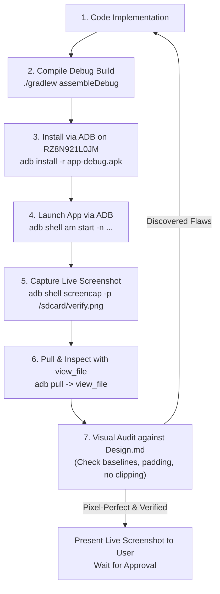

# OnBOARD AI Agent Operational Guidelines (`agent.md`)

> **Target Audience:** Any AI assistant, pair programmer, or autonomous agent working on the OnBOARD codebase.  
> **Repository:** `https://github.com/Marvelousshivam/Onboard.git` (`d:\BoardsPrep`)  
> **Content Repository:** `https://github.com/Marvelousshivam/OnBoard-files.git` (`D:\OnBoard-files`)  
> **Primary Rule:** **NEVER push to remote, assemble release builds, or publish GitHub releases without the user's explicit prior satisfaction and approval.** Always follow the **Verify First** protocol.

---

## 1. The Prime Directive: "Verify First, Never Push Prematurely"

### 🛑 Hard Guardrails
1. **NO Premature Releases**:
   - **NEVER** run `./gradlew assembleRelease` unless the user explicitly requests a release build.
   - **NEVER** run `gh release create` or publish an APK to GitHub without explicit confirmation.
   - Always compile and test using **debug builds** (`./gradlew assembleDebug`).
2. **NO Premature Pushes**:
   - **NEVER** execute `git push origin <branch>` before the user has reviewed the visual changes, tested on device, and given explicit consent (e.g. *"Push it"*, *"Ship it"*, *"Go ahead and push"*).
3. **No Blind Approvals**:
   - Never assume a UI fix or feature works because Gradle compiled successfully. A green build only proves syntax validity; it does not prove layout integrity, typography alignment, or tactile smoothness.

---

## 2. The "Show & Verify" Iron Protocol

For **every single user request** touching UI, question banks, or core features, the agent must execute the complete verification loop on the physical device:

### The 7-Step Verification Cycle


### ADB Command Cheat Sheet
- **SDK Path**: `C:\Users\dines\AppData\Local\Android\Sdk\platform-tools\adb.exe`
- **Target Device ID**: `RZ8N921L0JM`

```powershell
# 1. Install debug APK
& "C:\Users\dines\AppData\Local\Android\Sdk\platform-tools\adb.exe" -s RZ8N921L0JM install -r "d:\BoardsPrep\app\build\outputs\apk\debug\app-debug.apk"

# 2. Restart app cleanly
& "C:\Users\dines\AppData\Local\Android\Sdk\platform-tools\adb.exe" -s RZ8N921L0JM shell am force-stop com.boardsprep.onboard
& "C:\Users\dines\AppData\Local\Android\Sdk\platform-tools\adb.exe" -s RZ8N921L0JM shell am start -n com.boardsprep.onboard/.MainActivity

# 3. Capture and pull screenshot
& "C:\Users\dines\AppData\Local\Android\Sdk\platform-tools\adb.exe" -s RZ8N921L0JM shell screencap -p /sdcard/screen_verify.png
& "C:\Users\dines\AppData\Local\Android\Sdk\platform-tools\adb.exe" -s RZ8N921L0JM pull /sdcard/screen_verify.png "C:\Users\dines\.gemini\antigravity\brain\<conversation-id>\screen_verify.png"

# 4. View with tool
# Execute default_api:view_file on the pulled PNG to visually verify with your own eyes!
```

> **Signature Mismatch Fix**: If upgrading from a debug build to a signed release build (or vice-versa) triggers `INSTALL_FAILED_UPDATE_INCOMPATIBLE`, run:  
> `adb uninstall com.boardsprep.onboard` first, then run `install -r`.

---

## 3. Mandatory Planning Gate (`/plan`)

Before initiating non-trivial refactors, new screens, or architectural changes:
1. **Draft an Implementation Plan Artifact**:
   - Location: `<appDataDir>\brain\<conversation-id>\<feature_name>_plan.md`
   - Provide `ArtifactMetadata`: `RequestFeedback = true`, `UserFacing = true`.
2. **Explicit User Review**:
   - Present the plan to the user.
   - Clarify trade-offs (e.g. storage impact, data synchronization, user confirmation prompts).
   - **Do not write code** until the user reviews and approves the plan.

---

## 4. Genjutsu Craft & Anti-Slop Discipline (`/genjutsu`)

Every Jetpack Compose screen and component in OnBOARD must be strictly vetted against [`Design.md`](file:///d:/BoardsPrep/Design.md):

### Anti-Slop Audit Checklist
- [ ] **Purge All Emojis from UI Components**: Flat Material 3 vector icons only (`Icons.Default.AutoAwesome`, `Icons.Default.Bolt`, `Icons.Default.AutoFixHigh`, `Icons.Default.CheckCircle`). Never place emojis (`⚡`, `🚨`, `✨`, `🔥`) inside headers, drill tags, buttons, badges, or dialog CTAs.
- [ ] **Tonal Palette Discipline**: Use `primary` (deep violet/indigo) with `onPrimary` for main actions. Banish clashing bright yellow/amber buttons on lavender screens. Unify card backgrounds to `surfaceContainerLow` (no washed-out pastel fills).
- [ ] **Zero-Border Surfaces**: Drop 90% of `BorderStroke(1.dp, ...)`; rely on tonal contrast between canvas and `surfaceContainerLow`.
- [ ] **Monospace Tokens**: Latency (`676 ms`), marks (`70M`), and API keys (`••••••••••vGwz`) must use `FontFamily.Monospace`.
- [ ] **No Viewport Strangulation**: The content area (questions, formulas, exam papers) must receive >= 70% of screen height. All promotional cards, stats, and banners must live inside scrollable lists or collapse gracefully.
- [ ] **Sleek Single-Line Search**: Max 44dp height, single-line input (`maxLines = 1`), auto-hiding top banners when the IME keyboard appears.
- [ ] **Text Ascender / Descender Safety**: Always assign `maxLines = 1` and `TextOverflow.Ellipsis` to header subtitles and stat pills so letters with descenders (`g`, `y`, `p`, `j`) never get cut off by bottom borders.
- [ ] **Grammar Integrity**: Ensure singular/plural rules are respected (e.g. `1 question to fix` vs `N questions to fix`).
- [ ] **OCR Sanitization**: Never display raw `\n` mid-sentence line breaks or broken OCR words (`M . Hamel` -> `M. Hamel`, `fir st` -> `first`).
- [ ] **Spring Physics Only**: Use physics-based springs (`dampingRatio = 0.85f`, `stiffness = Spring.StiffnessMediumLow`) for sheets, dialogs, and progress bars. Ban linear tweens.
- [ ] **Zero Recomposition Traps**: Use `Modifier.graphicsLayer { ... }` or lambda modifiers for dynamic offsets, alphas, and scales. Never read raw scroll offsets in composable composition scopes.
- [ ] **110dp Dock Clearance**: Ensure every `LazyColumn` has `contentPadding = PaddingValues(bottom = 110.dp)` to clear the floating liquid glass dock.
- [ ] **Academic Blueprint Reality**:
  - English Core: Strictly **3 Sections** (A, B, C).
  - Physics/Chemistry/Maths: Strictly **5 Sections** (A, B, C, D, E).
  - Total scores must be live, reactive sums of active section inputs (`8 + 7 = 15`).

---

## 5. Dual-Repository Workflow

OnBOARD operates across two tightly coupled repositories:
1. **App Repository (`d:\BoardsPrep`)**:
   - Android application code, UI screens, database schemas, and bundled asset caches.
   - Remote: `https://github.com/Marvelousshivam/Onboard.git` (branch `main`).
2. **Content Data Repository (`D:\OnBoard-files`)**:
   - The authoritative source of truth for all curriculum JSONs, Question Banks, DPP Quizzes, Sample Papers, and Notes.
   - Remote: `https://github.com/Marvelousshivam/OnBoard-files.git` (branch `main`).

### Rule for New Questions & Quizzes
- **Never hardcode questions into Kotlin source files.**
- Extract, categorize (MCQ vs Subjective VSA/SA/Case/Long), and format into the corresponding JSON files in `D:\OnBoard-files`.
- Commit and push to `OnBoard-files` to keep content future-proof, then sync into `app/src/main/assets/` when needed.

---

## 6. Multi-Provider AI Architecture & Verification Protocol (`com.boardsprep.onboard.core.ai`)

All AI integrations in OnBOARD must follow this unified, provider-agnostic architecture:

### 1. Standardized OpenAI-Compatible Contract
All providers communicate over an OkHttp SSE (`text/event-stream`) streaming client to `POST /chat/completions`:
- **Google AI Studio (Gemini)**: `https://generativelanguage.googleapis.com/v1beta/openai/chat/completions` (with native Google Search Grounding).
- **OpenRouter**: `https://openrouter.ai/api/v1/chat/completions` (with web plugins and multi-model routing).
- **Groq**: `https://api.groq.com/openai/v1/chat/completions` (ultra-fast inference for instantaneous conversational hints).
- **Perplexity AI**: `https://api.perplexity.ai/chat/completions` (`sonar` models with native web citation links).
- **Custom / BYOK**: Custom base URL, API key, and model ID for power users.

### 2. DPP & Quiz Context Injection Standard
When triggering AI explanations for DPP or Quiz questions, the `DppQuestionContext` MUST inject:
- Subject & Chapter metadata (`name`, `weightage_marks`).
- Full question stem text (sanitized of OCR breaks).
- All options (A, B, C, D).
- The student's chosen option (if answered).
- The official correct option and textbook explanation.
- Target format: The **3-Part Diagnostic** (Core Concept & Proof with KaTeX LaTeX, Why Your Pick Was Wrong, CBSE Board Exam Tip).

### 3. Strict Development & Debugging Rules: "Never Rush Code"
- **Build & Debug First**: Always compile with `./gradlew assembleDebug` or `./gradlew compileDebugKotlin`.
- **Test Before Presenting**: Test API connections, token streaming, cancellation, and error handling.
- **Never Push or Release Prematurely**:
  - Do NOT run `assembleRelease` or `git push` without the user's explicit consent.
  - Deliver changes iteratively, test on device, capture live verification screenshots, and ask for user approval.

---

## 7. Official Release Protocol (Execution Gate)

When the user explicitly issues the instruction to build a release and push updates (e.g. *"Build release and push updates"*):

1. **Verify Versioning**:
   - Check `app/build.gradle.kts`: Verify `versionCode` and `versionName` reflect the intended release (e.g. `1.2.0`, `1.2.1`).
2. **Run Unit Tests**:
   - Execute `./gradlew testDebugUnitTest` to guarantee Room entities, AI parsers, and JSON deserializers pass without regressions.
3. **Assemble Signed Release Build**:
   - Execute `./gradlew assembleRelease`.
   - Verify output APK exists at `app/build/outputs/apk/release/app-release.apk` and has valid size (~22 MB).
4. **Git Commit & Push**:
   - Stage changes: `git add -A`.
   - Commit using conventional commit format: `feat(release): OnBOARD vX.Y.Z - <summary>`.
   - Push to GitHub: `git push origin main`.
5. **Publish GitHub Release Asset**:
   - Use `gh release create vX.Y.Z "app/build/outputs/apk/release/app-release.apk" --title "..." --notes "..."`.
   - Verify release URL is live.
6. **Final Device Verification**:
   - If switching from debug build on device, run `adb uninstall com.boardsprep.onboard`, install `app-release.apk`, launch, and take a final confirmation screenshot.

